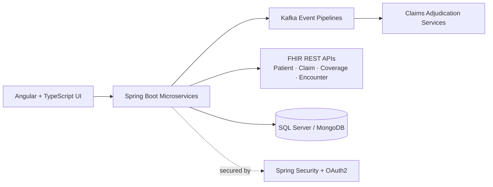

# CVS Health: HIPAA-Compliant Claims Platform (Case Study)

> **Role:** Software Developer · **Period:** May 2024 – Dec 2024 · **Location:** USA

## Overview

I worked on a healthcare claims platform handling **50,000+ claims per day**, building microservices and UI components for claims submission, real-time status tracking, and adjudication visibility.

## Impact at a Glance

| Area | Result |
| --- | --- |
| Scale | Platform handling **50,000+ daily claims** |
| Reliability | **~25% fewer downstream service failures** (retry/fault-tolerance patterns + query optimization) |
| Architecture | Synchronous claim calls replaced with **Kafka event-driven pipelines** for better throughput and decoupling |
| Interoperability | **FHIR-compliant APIs** for secure data exchange between healthcare systems |
| Security | **Spring Security + OAuth2** within HIPAA-compliant data access layers |

## High-Level Architecture (simplified)

## What I Built

### 1. Claims microservices and UI
- Built Spring Boot microservices and Angular/TypeScript components for claim submission, real-time status tracking, and adjudication visibility.

### 2. Event-driven pipelines
- Engineered Kafka pipelines to replace synchronous calls in claims workflows, improving throughput and service decoupling.

### 3. FHIR-compliant APIs
- Developed REST APIs for Patient, Claim, Coverage, and Encounter resources, enabling interoperability between healthcare systems and downstream applications.

### 4. Security and compliance
- Implemented Spring Security and OAuth2 inside HIPAA-compliant data access layers to protect PHI across claims services.

### 5. Resilience and delivery
- Applied retry and fault-tolerance patterns and optimized SQL Server and MongoDB queries.
- CI/CD on Azure DevOps with deployments to Docker, Kubernetes, and AWS ECS.

## Tech Stack

**Backend:** Java, Spring Boot, Spring Security, OAuth2, REST, FHIR
**Frontend:** Angular, TypeScript
**Messaging:** Apache Kafka
**Data:** SQL Server, MongoDB
**Cloud / DevOps:** Azure DevOps, Docker, Kubernetes, AWS ECS

---
[← Back to profile](https://github.com/bindukalam)

